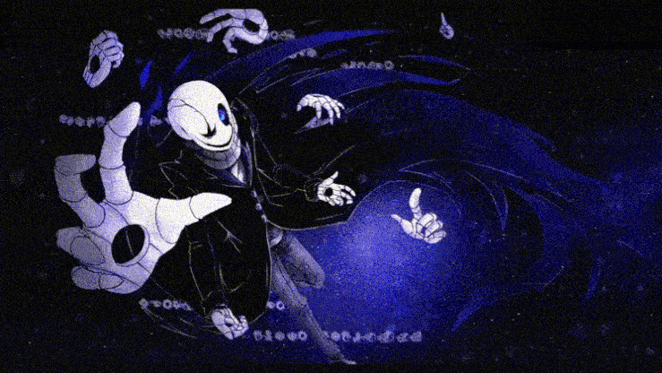

# ❓ Gaster


Description du rôle\
\
Gaster fait partie du camp des [Monstres](./)



Passif \
\
à l’annonce des rôles tu aura pas ta description mais la description d’un autre rôle avec les effets du rôles décrit\
à partir de 90 minute de jeux vous êtes au courant de votre rôle et perdez tout les effets et bonus de votre rôle de façade et gagné invisibilité et force quand vous enlevez votre armure\
(si vous avez un rôle permettant de connaître un autre rôle vous aurez un pseudo aléatoire)

(Vous ne pouvez pas avoir la description d’humain simple)\
(si une Toriel utilise son pouvoir sur lui Toriel verra le rôle de façade et non le rôle de gaster )&#x20;

 


<figure><figcaption></figcaption></figure>
