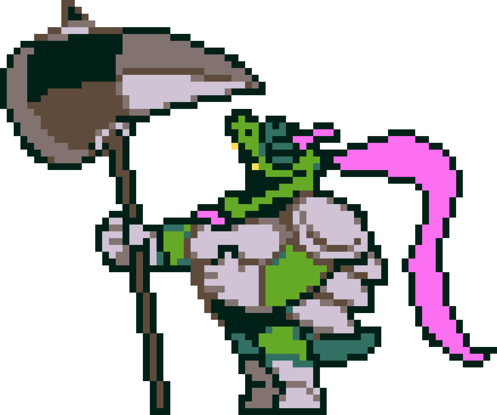

# 🐢 Gerson Boom


Description du rôle  

Gerson Boom doit gagner avec les autres [Monstres](./)



Passif\
\
Vous bénificiez d'une résistance 20% permanent&#x20;



Capacité\
\
Vous pourrez entrainez une personne peux importe sont camp alors choissisez bien ! \
\
Cette commande et possible une seule fois dans la partie \
\
/Train {joueur} après 10 minute d'entrainement (20 block) si la personne à Weakness permanent il la perdra \
\
Si la personne à aucun effet ou des effets hors force donc speed résistance etc.. il gagnera Force 20% permanent&#x20;


<figure><figcaption></figcaption></figure>
