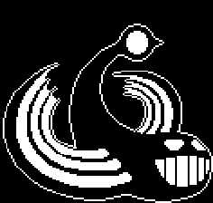

# 💡 Glyde


Description du rôle  

Glyde fait partie du camp des [Monstres](./)



Passif\
\
Il ne possède aucun effet particulier.



Capacité\
\
Il peux avoir une aura autour de lui infligeant  1 coeur toute les 10 secondes (15 block de rayon) /glyde aura.\
\
Avec la commande /glyde rayon vous recevrez un arc tirant un rayon offensif infligeant 3 coeur et avec un cooldown de 10 seconde .\
\
Il dispose notamment d'un objet permettant de révéler sa position à tout les joueurs pendant 5 minute.


<figure><figcaption></figcaption></figure>
