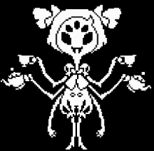

# 🕷️ Muffet


Description du rôle  

Muffet fait partie du camp des [Monstres](./)



Passif\
\
Il ne possède aucun effet particulier.



Capacité\
\
Vous aurez des Toiles d’araignée et un File qui pourra soignée un Monstre&#x20;

Vous aurez une salle vous pouvez vous tp seul dedans mais vous aurez  Speed 1 dans cette Salle (Cooldown entre l’utilisation de la salle un épisode fin de la salle après 10 minute    ) 30 block pour tp&#x20;

Si 1 Humain tombé dans cette salle donne 1 coeur à l’inverse si muffet tombe elle perdra des coeurs on nombre d’humain dans la salle exemple 5 Humain dans la salle Muffet tombe elle perdra 5 coeur&#x20;


<figure><figcaption></figcaption></figure>
