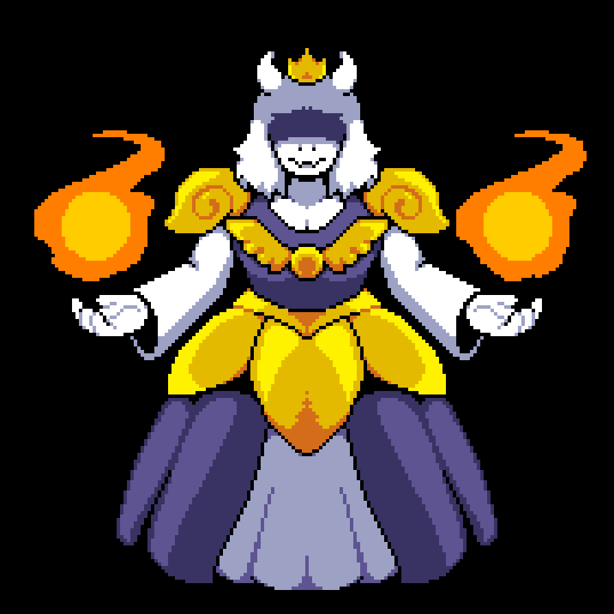

# 🥧 Toriel


Description du rôle  

Toriel fait partie du camp des [Monstres](./)



Passif\
\
Il ne possède aucun effet particulier.



Capacité\
\
Toriel à une commande /To \<joueur> qui permet à Toriel de voirs le rôle du joueur visé \
\
Au début de chaque nuit tu peux voirs qu'elle rôle à tuer qui&#x20;


<figure><figcaption></figcaption></figure>
