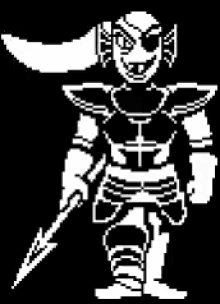

# 🐟 Undyne


Description du rôle  

Undyne fait partie du camp des [Monstres](../)



Passif\
\
Vous possédez <mark style="color:$danger;">Force 1</mark> Permanent



Capacité\
\
Si plus de la moitié des monstres sont mort vous pourrez vous réanimer une fois réanimé un message apparaît dans le chat "Undyne The Undying"


<figure><figcaption></figcaption></figure>
