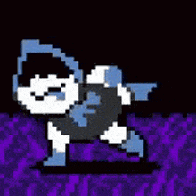

# 🏍️ Lancer


&#x20;                                                                  Description du rôle \
\
<mark style="color:$warning;">Lancer</mark> est dans aucun camp au début de la partie et devra s'adapter en conséquence.

A 90 minute de jeux si + de Monstre que d'Humain sont vivant il deviendra Solitaire et devra désormais gagner seul, à l'inverse il devra gagner avec les Monstres &#x20;



&#x20;                                                                        Capacité \
\
Avec la commande _**/Lan**_ il peux faire apparaitre un cheval et le chevauché \
\
Si il devient solitaire il à le droit à la T4 les autres rôles Solitaire seulement si il est solitaire&#x20;


<figure><figcaption></figcaption></figure>
