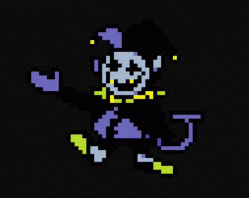

# 🤡 Jevil


&#x20;                                                                  Description du rôle \
\
<mark style="color:violet;">Jevil</mark> doit être le dernier survivant pour gagner la partie.



&#x20;                                                                         Capacité \
\
<mark style="color:violet;">Jevil</mark> obtient trois cibles à 25 minutes de jeu.

Si vous tuez une cible, vous obtiendrez <mark style="color:$danger;">Force 1</mark>, <mark style="color:green;">Résistance 1</mark> ou <mark style="color:blue;">Speed 1</mark> permanant aléatoirement.

Si une de vos cibles meurt de la main d'un autre joueur, vous ne gagnerez pas d'effet.


<figure><figcaption></figcaption></figure>
